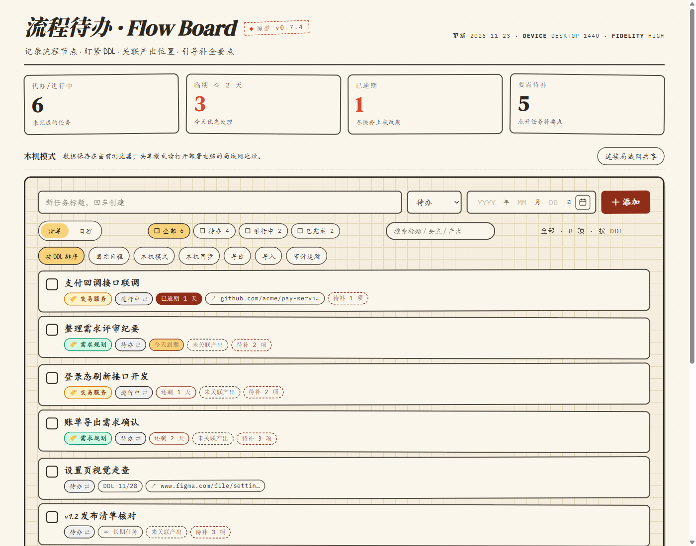
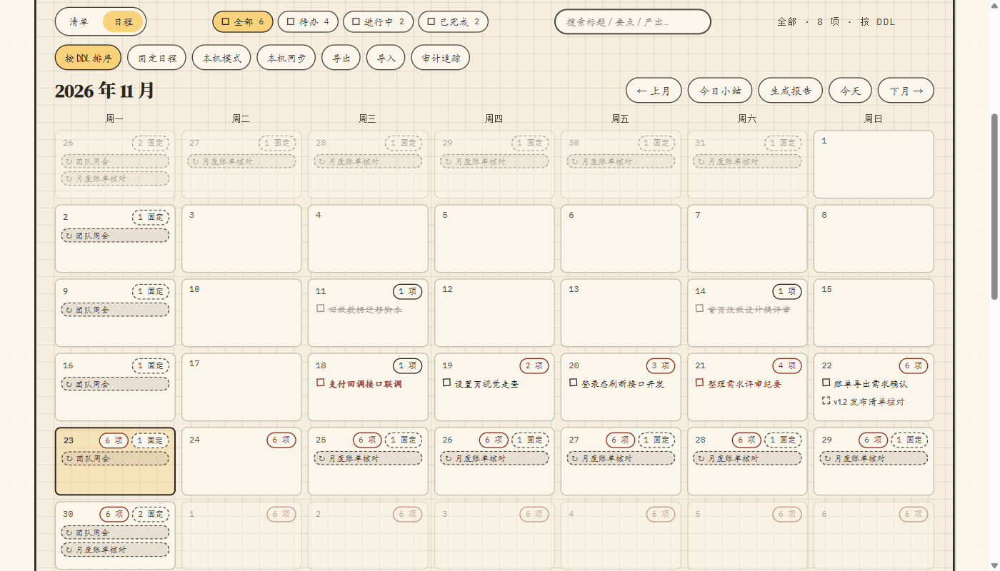

# 流程待办 · Flow Board

**今天该推进什么、哪件事快到期、这周交付了什么？一块看板就能看清。**

Flow Board 把任务看板、日历和日报周报放在同一个页面。个人打开网页即用，团队也可以在自己的局域网里共用一块看板。无需构建。

**[在线体验个人版](https://shadowwitheagle.github.io/todo-flow/todo-flow.html)** · **[给 Agent 的部署入口](AGENTS.md)** · **[局域网部署手册](LAN_SETUP.md)**

## 界面预览

### 清单视图

按截止日期查看任务，阶段、临期和逾期状态直接显示在卡片上。

### 日程视图

在月历里查看每日待办和重复日程，点开日期可查看当天清单。

## 从记下待办到交付复盘

- **把任务推进下去。** 输入标题回车新建，沿着「待办 → 进行中 → 已完成」推进。为任务补上目标、验收标准、产出位置和备注；临期与逾期事项会高亮，任务可按标签、阶段和截止日期整理。
- **把今天排清楚。** 日历把任务、小结、固定日程和当日速记放在同一天，点开即可回看当天新增、推进和完成了什么。
- **把周报写快一点。** 从日历小结生成日报或周报，支持复制和下载文本。需要迁移或备份时，可以导出 JSON。

## 选择你的使用方式

<table>
  <thead>
    <tr>
      <th width="136" scope="col">场景</th>
      <th scope="col">怎么开始</th>
      <th scope="col">数据存在哪里</th>
    </tr>
  </thead>
  <tbody>
    <tr>
      <td nowrap>个人在线用</td>
      <td><a href="https://shadowwitheagle.github.io/todo-flow/todo-flow.html">打开个人在线版</a></td>
      <td>当前浏览器的站点存储</td>
    </tr>
    <tr>
      <td nowrap>个人离线用</td>
      <td>下载仓库，直接打开 <code>todo-flow.html</code></td>
      <td>当前浏览器的本机页面存储，可导出或使用本机文件同步</td>
    </tr>
    <tr>
      <td nowrap>团队一起用</td>
      <td>在可信局域网内运行 Python 服务，按 <a href="LAN_SETUP.md">局域网手册</a>启动</td>
      <td>部署电脑的 SQLite 数据库，在线成员共享任务、日程、便签和活动日志</td>
    </tr>
  </tbody>
</table>

个人在线版和离线版都使用浏览器本地存储。换浏览器或访问地址时，可用 JSON 导出、导入迁移。局域网版以显示名称标记活动，网络可达的成员拥有读写权限，请仅在可信局域网使用。

## 交给 Agent 部署

部署时把下面这一条链接发给 Agent 即可。入口包含模式选择、跨平台启动命令、数据位置和验收步骤。若未指定部署目标，Agent 先启动本机预览并回传访问地址。

[https://github.com/ShadowwithEaGLE/todo-flow/blob/master/AGENTS.md](https://github.com/ShadowwithEaGLE/todo-flow/blob/master/AGENTS.md)

## 项目结构

| 文件 | 用途 |
| --- | --- |
| `todo-flow.html` | 单文件应用，原生 HTML、CSS、JavaScript |
| `server.py` | 局域网共享服务，使用 Python 标准库和 SQLite |
| `start-flow-board.cmd` | Windows 局域网启动器 |
| `version.json` | 在线更新检查所用的版本信息 |
